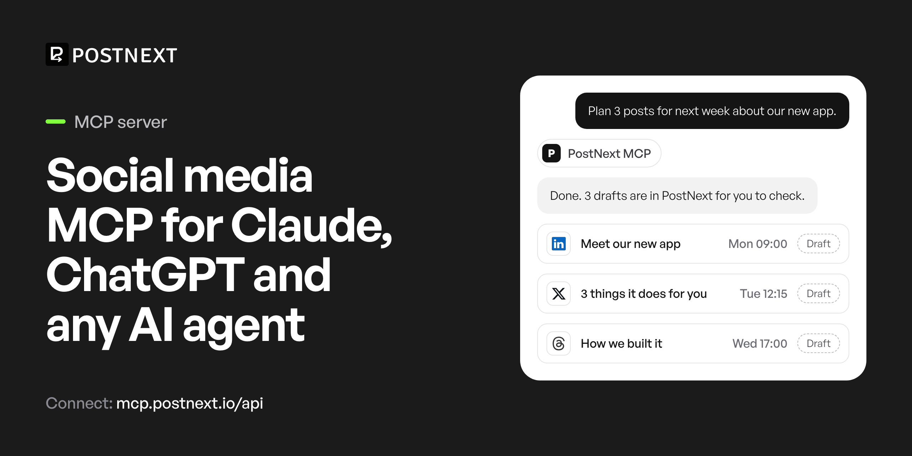
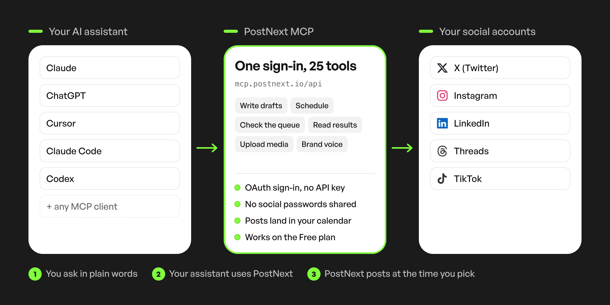
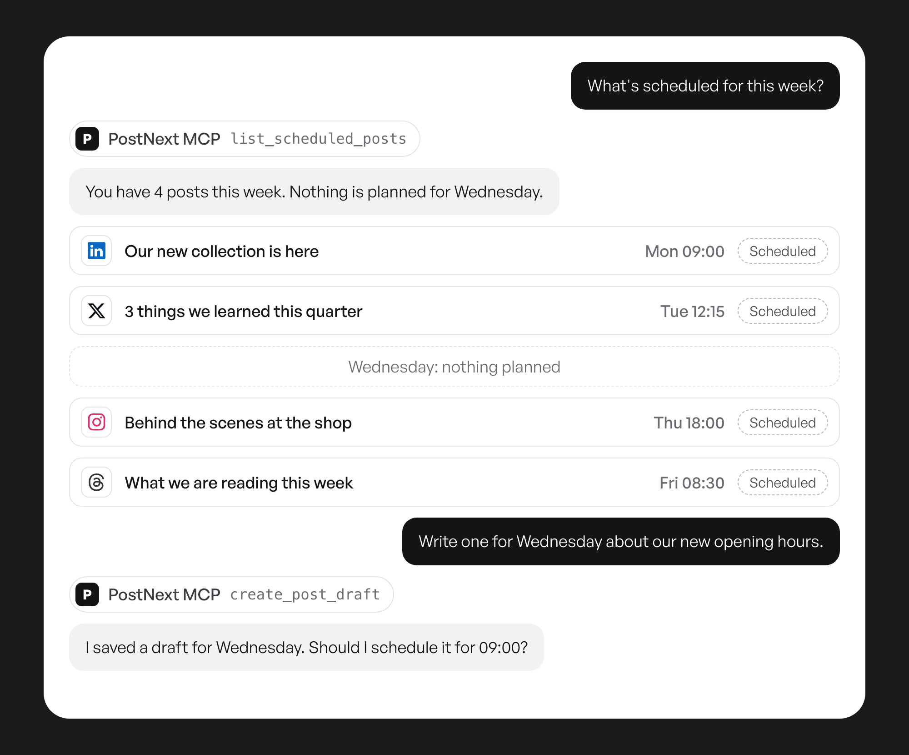

# Social media MCP for Claude, ChatGPT and any AI agent



**PostNext MCP is a hosted social media MCP server.** Connect it once to
Claude, ChatGPT, Cursor, Codex or any other AI agent, then ask in plain
words: "plan next week's posts", "what's scheduled?", "turn this article
into a thread". Your assistant writes the posts, schedules them on X,
Instagram, LinkedIn, Threads and TikTok, and tells you what is scheduled and
what went out.

[](https://www.npmjs.com/package/postnext-mcp)
[](https://registry.modelcontextprotocol.io/v0/servers?search=io.postnext/postnext)
[](LICENSE)

[How it works](https://postnext.io/mcp) ·
[Setup guides](https://postnext.io/ai-agents) ·
[Full docs](https://postnext.io/mcp/docs) ·
[For developers](https://postnext.io/for/developers) ·
[Pricing](https://postnext.io/pricing)

- **Server URL**: `https://mcp.postnext.io/api`
- **Sign-in**: OAuth (no API key needed in chat apps)
- **Cost**: included in every PostNext plan, Free plan too
- **Status**: production, [v1.5.1](#versions-and-endpoints), listed in the
  official MCP Registry as `io.postnext/postnext`
- **Tools**: 25 · **Resources**: 4 · **Prompts**: 4

---

## What is a social media MCP?

MCP (Model Context Protocol) is an open standard that lets an AI assistant
use other apps. A **social media MCP** is an MCP server for your social
accounts: once it is connected, your assistant can write, schedule and
review posts for you, instead of only suggesting text you copy and paste.

PostNext MCP is run by [PostNext](https://postnext.io), a social media
scheduler. Every post your assistant creates lands in your PostNext calendar,
where you can check it, change it or cancel it before it goes out.



1. **You ask** your assistant in plain words.
2. **Your assistant uses PostNext**: it reads your channels and brand voice,
   writes drafts and schedules them.
3. **PostNext posts** at the time you pick, through each network's official
   API, even after you close the chat.

## What you can ask



Copy any of these into your assistant once PostNext is connected:

- "What's scheduled for this week?"
- "Plan five posts for next week from this article. Show me the plan first,
  then save them as drafts."
- "Turn this blog post into an X thread."
- "Audit my queue for the next 14 days. Flag duplicates and gaps."
- "Which of my channels need reconnecting?"
- "Write a LinkedIn post about our new pricing page and schedule it for
  Tuesday at 09:00."

Longer worked examples are in [recipes](#recipes).

## Supported social networks

| Network | What your assistant can do | Guide |
|---|---|---|
| **X (Twitter)** | Write and schedule posts and threads, read likes, replies, reposts and impressions | [X MCP server](https://postnext.io/mcp/x) |
| **Instagram** | Schedule posts with at least one image or video. Needs a Business or Creator account | [Instagram MCP server](https://postnext.io/mcp/instagram) |
| **LinkedIn** | Write and schedule posts, confirm they went out | [LinkedIn MCP server](https://postnext.io/mcp/linkedin) |
| **Threads** | Write and schedule posts and threads, confirm they went out | [Threads MCP server](https://postnext.io/mcp/threads) |
| **TikTok** | Schedule your videos with captions, confirm they went out | [TikTok MCP server](https://postnext.io/mcp/tiktok) |

These five can be connected and posted to through the MCP. The PostNext app
itself supports more [channels](https://postnext.io/channels).

## Connect in a few minutes

Before you connect an assistant:

1. [Sign up at postnext.io](https://postnext.io) and finish the plan step in
   the web app: a 7-day free trial (it asks for a card) or **Continue with
   Free**. Until then your assistant can draft but not schedule.
2. Connect at least one social account in PostNext, or ask your assistant
   for a connect link once it is set up.

Then pick your assistant below. Each one has a full guide on postnext.io, and
those guides are the ones kept current. Menus in AI apps move; the steps here
were last matched to the guides on 26 November 2026.

### Claude (desktop app and claude.ai)

1. In Claude, open **Customize** → **Connectors**. Select **+ Add**, then
   **Add custom connector**.
2. Name it PostNext, paste `https://mcp.postnext.io/api` and select
   **Continue**. Keep the options marked Detected and select **Add**.
3. Select **Connect** and approve the PostNext sign-in.

On Team and Enterprise plans an owner adds it once under **Organization
settings** → **Connectors**, then members select **Connect**. On Claude
Desktop you can also use the one-click link at
[postnext.io/mcp/connect](https://postnext.io/mcp/connect).
Full guide: [PostNext for Claude](https://postnext.io/ai-agents/claude).

### ChatGPT

1. In ChatGPT on the web, open **Plugins**, select **+** and choose **Add
   custom MCP server**.
2. Name it PostNext, paste `https://mcp.postnext.io/api` under Connection and
   choose **OAuth**. Tick **I understand and want to continue**.
3. Select **Create as a plugin**, install it, and sign in to PostNext when
   ChatGPT asks. In a chat, type **@** and pick PostNext.

OpenAI says full MCP access, with write tools, is on ChatGPT Business,
Enterprise and Edu, and Pro can connect custom servers with read access. In a
Business workspace, an admin or owner creates the plugin.
Full guide: [PostNext for ChatGPT](https://postnext.io/ai-agents/chatgpt).

### Claude Code

```bash
claude mcp add --transport http --scope user postnext https://mcp.postnext.io/api
```

`--scope user` makes PostNext available in every project. Then start Claude
Code, type `/mcp`, select postnext and sign in to PostNext in your browser.
Full guide: [PostNext for Claude Code](https://postnext.io/ai-agents/claude-code).

### Cursor

Add this to `~/.cursor/mcp.json` (or `.cursor/mcp.json` for one project):

```json
{
  "mcpServers": {
    "postnext": {
      "url": "https://mcp.postnext.io/api"
    }
  }
}
```

Cursor opens the PostNext sign-in on first use. Approve it once.
Full guide: [PostNext for Cursor](https://postnext.io/ai-agents/cursor).

### Codex

```bash
codex mcp add postnext --url https://mcp.postnext.io/api
codex mcp login postnext
```

Or add `[mcp_servers.postnext]` with `url = "https://mcp.postnext.io/api"` to
`config.toml` in your `.codex` folder, then run `codex mcp login postnext`.
Full guide: [PostNext for Codex](https://postnext.io/ai-agents/codex).

### Other assistants

GitHub Copilot, Windsurf, Gemini, Manus, Perplexity Computer and more have
their own guides in the [AI agents directory](https://postnext.io/ai-agents).
Any client that can add a remote MCP server works with the same URL.

`npx postnext-mcp <client>` prints the config for `claude-code`,
`claude-desktop`, `cursor`, `codex` or `chatgpt`. It is a setup helper only:
the server is hosted, so there is nothing to install or run.

### Your own scripts and agents (API key)

For code that can't do OAuth, create an API key at
[postnext.io/account/api-keys](https://postnext.io/account/api-keys) and send
it to `https://mcp.postnext.io/api` as `Authorization: Bearer apikey_<uuid>`
on every request. Building your own integration without MCP? The PostNext
REST API takes the same key in an `x-api-key` header: see
[PostNext for developers](https://postnext.io/for/developers).

## What can the PostNext MCP do?

All 25 tools, grouped by what they are for:

| Area | In plain words | Tools |
|---|---|---|
| **Account + plan** | See your plan, what you have left this month and account health | `get_plan`, `get_plan_limits`, `get_account_health` |
| **Teams** | List your teams and switch between them | `list_teams`, `set_current_team` |
| **Channels** | See connected accounts and get a link to connect a new one | `list_connected_accounts`, `connect_channel` |
| **Drafts** | Write, edit, list and delete drafts | `create_post_draft`, `update_post_draft`, `list_drafts`, `delete_draft` |
| **Schedule** | Schedule a post, cancel it, see the queue and check if it went out | `schedule_post`, `cancel_scheduled_post`, `list_scheduled_posts`, `get_publish_status` |
| **Posts** | Find past posts and read their results | `get_post`, `search_posts`, `get_post_metrics` |
| **Analytics** | Best time to post and results per channel | `get_best_time_to_post`, `get_channel_analytics` |
| **Media** | Add images and videos to your library | `upload_asset`, `request_asset_upload`, `import_chat_file` |
| **Brand** | Save your brand voice, themes and hashtags | `update_brand_profile` |
| **Meta** | Find the right tool for a job | `search_tools` |

Four tools need a paid plan: `get_account_health`, `get_best_time_to_post`,
`update_post_draft` and `update_brand_profile`. Everything else works on the
Free plan, within its limits: 10 posts and 10 AI credits a month, 1 connected
channel and 10 MB of storage. Each draft your assistant saves uses 1 AI
credit. See [postnext.io/pricing](https://postnext.io/pricing) for current
limits.

Every tool, what it returns and its errors: [docs/tools.md](docs/tools.md)
or [postnext.io/mcp/docs](https://postnext.io/mcp/docs).

## MCP or API: which one do I need?

| You want to | Use |
|---|---|
| Ask Claude, ChatGPT or another assistant to handle your posts | This MCP server: [postnext.io/mcp](https://postnext.io/mcp) |
| Post from your own app, script or backend | The PostNext REST API: [postnext.io/for/developers](https://postnext.io/for/developers) |
| Give an agent a ready-made skill, with no connector to set up | [`postnext-social-manager`](https://github.com/postnextio/postnext-social-manager), which uses the REST API with an API key |

## FAQ

### Is PostNext an MCP server or an API?

Both. The MCP server is for AI assistants like Claude and ChatGPT
([postnext.io/mcp](https://postnext.io/mcp)). The REST API is for your own
code ([postnext.io/for/developers](https://postnext.io/for/developers)).
Both work on the same PostNext account.

### Which AI assistants work with PostNext?

Claude, Claude Code, ChatGPT, Codex, Cursor, GitHub Copilot, Windsurf, Gemini
and any other client that can add a remote MCP server. See the
[AI agents directory](https://postnext.io/ai-agents) for each setup.

### Which social networks does it post to?

X (Twitter), Instagram, LinkedIn, Threads and TikTok.
[See the networks](#supported-social-networks).

### Is it free?

Yes. MCP access is included in every PostNext plan, including Free (10 posts
and 10 AI credits a month, 1 channel). Each saved draft uses 1 AI credit, and
four tools need a paid plan. [See pricing](https://postnext.io/pricing).

### Can ChatGPT post to social media with PostNext?

Yes, on ChatGPT Business, Enterprise or Edu, where OpenAI allows write
tools: add PostNext as a custom MCP server from the Plugins page. On Pro,
ChatGPT can connect with read access only.
[ChatGPT setup guide](https://postnext.io/ai-agents/chatgpt).

### Will my assistant post without asking me?

It can. PostNext does not add its own confirmation step: if your assistant
schedules a post, it is queued. Most AI clients, including Claude, ChatGPT,
Cursor and Claude Code, ask you before a tool that changes something runs,
and the built-in prompts tell the assistant to wait for your OK. Every
scheduled post stays in your PostNext calendar, where you can cancel it until
it goes out.

### Do I need an API key?

Not in most chat apps and editors: Claude, ChatGPT, Cursor and Claude Code
sign in with OAuth. Use an API key only for your own scripts.
[PostNext for developers](https://postnext.io/for/developers).

### How do I remove access?

Disconnect PostNext in your AI client's settings, or revoke the client under
**Connected MCP apps** on your PostNext account page
([postnext.io/account/api-keys](https://postnext.io/account/api-keys)).

## Reference

### Resources

Context your assistant can read on demand, so it doesn't have to ask you
again. Details: [docs/resources.md](docs/resources.md).

| URI | What it returns |
|---|---|
| `postnext://account/summary` | Plan, usage this month, channels connected |
| `postnext://teams/current` | Currently-selected team |
| `postnext://channels/connected` | All connected social handles for the active team |
| `postnext://brand-profiles/active` | Brand voice, themes, hashtags |

### Prompts (ready-made workflows)

Details: [docs/prompts.md](docs/prompts.md).

| Name | What it does |
|---|---|
| `weekly-plan` | Proposes 5 to 10 drafts for next Monday to Friday across your active platforms, in your brand voice. Creates them only after you confirm |
| `draft-thread` | Drafts a 5 to 10 post X or Threads thread from a topic or URL and shows it numbered. Saves drafts only after you confirm |
| `audit-queue` | Walks the next N days (1 to 30, default 7) of scheduled posts and flags duplicates, overload and gaps. Read-only |
| `channel-sweep` | Lists connected and missing channels, flags stale ones (not synced for 7+ days) and suggests what to connect. Asks before creating any sign-in link |

The prompts guide your assistant; they are not enforced by the server.

### Recipes

Paste-ready prompts with notes on what your assistant does behind the scenes:

- [Weekly content plan](recipes/weekly-content-plan.md): plan next week's
  posts across your connected channels, in your brand voice
- [Draft a thread from an article](recipes/thread-from-article.md): turn
  a URL into a 5 to 10 post thread
- [Audit the scheduled queue](recipes/audit-scheduled-queue.md): a read-only
  walk through your next N days, flagging duplicates, overload and gaps
- [Channel-connection sweep](recipes/channel-connection-sweep.md): review
  which channels are connected or stale, and connect the missing ones

### Versions and endpoints

| Endpoint | Status | Notes |
|---|---|---|
| `https://mcp.postnext.io/api` | **Canonical** | Use this |
| `https://postnext.io/mcp/api` | Deprecated | Still served for older integrations but will be removed; do not use for new ones |

The server reports `version: 1.5.1` on `initialize`. Tools can be added or
retired without a version change, so the live `tools/list` is the source of
truth.

### Auth and security

- Two ways to sign in: **OAuth 2.0** (chat apps and editors) or an **API
  key** (`Bearer apikey_<uuid>`, managed at
  [postnext.io/account/api-keys](https://postnext.io/account/api-keys))
- Your assistant only sees what you authorize, and you can revoke a client
  at any time under **Connected MCP apps** on your account page
- No social media passwords are shared: PostNext posts through each
  network's official API
- Requests are rate-limited: 300 per 2 minutes per token once signed in,
  60 per 2 minutes per IP before sign-in. Live limits are in the
  `RateLimit-*` response headers, and a limited request gets HTTP 429
- Security disclosure: [postnext.io/security](https://postnext.io/security) ·
  RFC 9116 `security.txt` published at `/.well-known/security.txt`
- Privacy: [postnext.io/privacy](https://postnext.io/privacy). The MCP data
  flow is detailed under "MCP Server and AI Assistant Access"

### Repo docs

The hosted reference is at [postnext.io/mcp/docs](https://postnext.io/mcp/docs).
The same material lives in this repo for offline or fork use:

- [Quickstart](docs/quickstart.md): connect from Claude Desktop, claude.ai,
  Claude Code, Cursor, Codex, ChatGPT or a programmatic client
- [Tool reference](docs/tools.md): all 25 tools, gating, error envelopes
- [Resource reference](docs/resources.md): the 4 MCP resources, with example
  payloads
- [Prompt reference](docs/prompts.md): the 4 ready-made workflows and their
  arguments

## License

[MIT](LICENSE). Documentation and examples are free to copy, fork and adapt.
The MCP server itself is hosted by PostNext; see
[Terms of Service](https://postnext.io/terms).

## Links

- Social media MCP: [postnext.io/mcp](https://postnext.io/mcp)
- Setup guides for every assistant: [postnext.io/ai-agents](https://postnext.io/ai-agents)
- For developers (REST API): [postnext.io/for/developers](https://postnext.io/for/developers)
- Pricing: [postnext.io/pricing](https://postnext.io/pricing)
- PostNext app: [app.postnext.io](https://app.postnext.io)
- Social-manager skill: [github.com/postnextio/postnext-social-manager](https://github.com/postnextio/postnext-social-manager)
- Support: [contact@postnext.io](mailto:contact@postnext.io)

---

Built by the team at [PostNext](https://postnext.io), the agentic social
media scheduler. Pull requests on these docs welcome.
